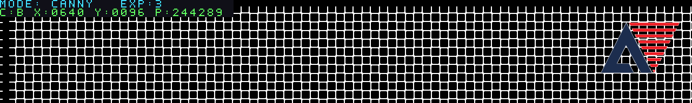

# 直接使用安路资料包的 Logo 例程代码

本文记录 19:34 原 Logo 版的历史构建和验证。当前交付已更新为 [颜色跟踪抗丢帧版](TARGET_TRACKING_STABILITY.md)，继续使用相同原 ROM；下面的旧位流哈希和旧文字像素计数不代表当前 `best_result`。

2026-10-17。按用户要求，替换之前的裁剪/16 色转换方案，直接调用资料包内 `lab_ex3_osd` 原始 Logo ROM，并移植其地址计算和透明像素叠加规则。保留左上角已经恢复的状态文字、白场 V2、边缘去孤点/补断线和原按键行为。

## 例程位置与原文件核对

使用的资料包：

`D:/Downloads/qiansai/HX1P35A_Contest_202606/3_yuanlitu/SC520CS/lab_ex3_osd_SC520.zip`

压缩包内目录：`lab_ex3_osd_SC520/lab_ex3_osd/user_source/hdl_source/`。

| 原文件 | 用途 | SHA256 |
| --- | --- | --- |
| `anlogic_logo_rom.v` | 原始 RGB888、透明标志及全部 Logo 像素 | `37c76680345f17a85632b7835e46a3a197cf75fdd91ca6a970b75f5346e7a9f8` |
| `hdmi_mixer.v` | Logo 坐标寻址和命中像素叠加 | `e0b3fa961da8bd91d58175ad57eec38e90cc9295215c854154bc0bf2f2f987c7` |

SC500 的配套 `lab_ex3_osd_SC500_720P.zip` 中这两份文件的内容也一致。本次已直接检查压缩包内文件，不仅检查解压目录中的副本。

## 工程中实际使用的代码

原 ROM 已原样复制为：

`reference_edge_project/user_source/hdl_source/hx1p35_port/anlogic_logo_rom.v`

已与压缩包内原文件逐字节核对相同。没有更名模块、改色、裁剪图片或将它重写成自制字模。TD 工程 `.al` 已改为编译这份原文件，而非上一版 `hx_anlogic_logo_rom.v`。

`.gitattributes` 对原 ROM 禁用换行符转换，避免 Git 提交/检出后破坏与资料包的逐字节一致性。

原 `hdmi_mixer.v` 的关键逻辑是：

```verilog
S_logo_addr = S_logo_y * LOGO_W + S_logo_x;
if(S_logo_pixel[24]) begin
    S_osd_hit   = 1'b1;
    S_osd_color = S_logo_pixel[23:0];
end
```

当前 `hx_vision_pipeline.v` 直接例化 `anlogic_logo_rom`，沿用 `y * 160 + x` 地址、`O_pixel[24]` 命中/透明标志和 `O_pixel[23:0]` RGB 原色。只做两项接入适配：

1. 原例程放在左上角；这里放在右上角，以免遮住恢复的状态文字。
2. 原 ROM 为组合输出，直接串接的首次综合显示 -3.615 ns 时序违规。保留 ROM 不动，在其前增加地址预取寄存器，图像、坐标和全部五个视频标志同步经过预取、查表、叠加三级。相对上一版多一拍，但各模式和控制/像素严格对齐，DDR 读时序不变；RAW 渐变图逐像素检查对齐关系。

没有整份替换当前 HDMI mixer，避免同时引入原例程的帧计数文字、改变当前读帧或调试逻辑。

## 显示行为

- Logo 全部使用 160×160 坐标；1280×720 时区域为 x=1104～1263、y=8～167。
- 空白像素透明，原画面透出；不再绘制上一版的白色矩形背景。
- 原图包含 6,387 个有效像素和完整抗锯齿颜色，不作 16 色量化。
- 左上两行模式/曝光、目标颜色/坐标/像素数文字保持不变。
- 四种模式均叠加；Logo 不进入 Canny、颜色目标或 AE 的统计。
- `ENABLE_ANLOGIC_LOGO=0` 仍可关闭 Logo，`ENABLE_STATUS_OSD=0` 可独立关闭文字。

## 核对和仿真

`tools/prepare_example_logo_verification.py` 直接读取上述 ZIP 中的原 ROM，先核对当前源文件逐字节一致，再生成独立 25 位参考像素，不经过上一版的素材转换脚本。

```powershell
python tools/prepare_example_logo_verification.py D:/Downloads/qiansai/HX1P35A_Contest_202606/3_yuanlitu/SC520CS/lab_ex3_osd_SC520.zip D:/Downloads/qiansai/tmp/example_logo_vectors_new
python -m unittest discover -s tests -p 'test_*.py'
```

输出目录必须不存在。编译工程不需要资料包或外部图片，原 ROM 已完整包含在源文件中。

`tb_example_logo_rom.sv` 遍历全部 32,768 个地址，核对 6,387 个有效 RGB888 像素及透明默认值。`tb_logo_osd.sv` 检查四种模式的完整 160×160 区域、透明位置、状态文字、视频标志以及区域外图像/目标/AE 统计一致性。

上一版的转换脚本和 `hx_anlogic_logo_rom.v` 暂留作历史参考，**不在当前 `.al` 源码清单中，也没有被例化**；旧位流仍保留，不会混称为本版。

三级流水线版本已重新验证：

- Python 17 项测试通过。
- 原 ROM 独立 RTL 仿真：32,768 地址全部一致，其中 6,387 个原色有效像素，其余地址为透明默认值。
- 整合叠加 RTL 仿真：四种模式各一帧 1280×192，共 983,040 个输出像素，覆盖完整 Logo 及边界。
- 四帧内 25,548 个有效 Logo 像素保持原 RGB888，76,852 个区域内透明像素保留原底图。
- 状态文字覆盖青色 3,228、无目标红色 1,072、有目标绿色 2,440 个像素；叠加区域外图像、视频标志、目标/AE 统计与关闭叠加的版本一致。
- 两项 ModelSim 测试均无错误或警告，使用厂商 ERAM/GSR 模型完成流水线对照。
- 独立 RAW 渐变图逐点核对三拍图像/坐标对齐，灰度值与预期一致；透明区域也参与底图一致性检查。
- 关闭叠加的原模式回归通过：24,576 个有效输出像素，边缘精修与旁路的差异仍为 1,838 个像素。
- 720p 二值精修回归四帧 3,686,400 个像素通过；没有修改其算法。

RTL 合成测试图预览（不是摄像头实拍）：



## 最终构建与交付

- 原组合 ROM 直接串接的试构建 `example_logo_20261017_a` 时序不合格，已停止且未交付。
- 地址预取三级对齐版完整构建位于 `D:/Downloads/qiansai/tmp/example_logo_20261017_b/`；综合、布局布线和位流生成通过。
- 最终 Setup WNS +0.213 ns，Hold WNS +0.020 ns，TNS=0，违规端点 0。
- Slice 16,350/21,216（77.06%），LUT6 14,188，寄存器 14,815，ERAM 56/108，DSP 24/40。使用原组合查表后占用更多 LUT；仍在器件容量内。
- 位流生成于 2026-10-17 19:34:55（本机时间）。标准文件 1,789,539 字节，压缩文件 1,417,521 字节。
- 存档：`bitstreams/camera_example_logo_20261017.bit`、`camera_example_logo_20261017_compress.bit`。
- 标准位流 SHA256：`CD8D4F328904B4DB33A0358F4AD855B86C478A3BF4B2024CA85F593726BB91C7`。
- 压缩位流 SHA256：`48E52DDFBCCE709F825A99510D0ECF0BEF24E390797F02BA92E8B1FD5B4466AC`。
- 已同步标准/压缩位流、BID 和时序摘要到原 `reference_edge_project/td_project/camera_to_dsi_display_Runs/best_result/`。
- 替换前所有普通文件已复制到 `best_result/backup_before_example_logo_20261017_193455/`；其中旧 19:13 标准位流 SHA256 为 `0F572D00E2BA6593E063233BE615E4EBD111766C6DA0D564BB7C31E8E98B3506`。
- 原工程 `syn_1/phy_1` 数据库未覆盖，完整报告请查看上述独立构建目录。
- 工作区与构建副本源文件哈希已核对：`hx_vision_pipeline.v` 为 `5B93B6A1723CF8B427EAD3818CFF36A46F2C7947295FF5BDE84A16FB8893FDF1`，原 ROM 仍为前述 `37c766...`。

烧录原 `best_result/camera_to_dsi_display.bit` 即可，无需额外标定。实际摄像头画面仍需用户烧录确认；本次未代为提交或推送 GitHub。`.bit` 文件仍按现有规则忽略。
