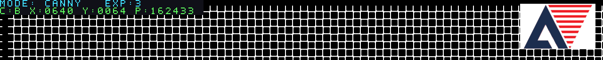

# 安路 Logo 与状态文字恢复

> 历史版本：本文记录 19:13 的裁剪/16 色 Logo 方案。用户随后要求直接使用原例程代码，当前实现改为 [原版 ROM 与透明叠加](EXAMPLE_LOGO.md)。本文的位流、白底和 160×96 尺寸仅属于旧版。

2026-10-17。本次只修改显示末端叠加，保留白场 V2 和边缘去小点簇/短断口连接。没有修改摄像头、AWB/AE、颜色目标阈值、Canny 阈值或按键行为。

## 显示布局

- 左上角：恢复原两行状态文字，区域为 x=0～431、y=0～31。
- 第一行：`MODE: RAW/GRAY/COLOR/CANNY`、`EXP: A/0/1/2/3`，青色文字配深色底；A 表示自动曝光。
- 第二行：`C:` 目标主颜色、`X:` / `Y:` 颜色目标中心、`P:` 颜色目标像素数。无目标时显示红色和横线，有目标时显示绿色和实际数值。
- 第二行的坐标与面积来自颜色目标统计，不是边缘像素计数，也不是 FPS。
- 右上角：参考工程自带的安路标志，白底 160×96；1280×720 时位于 x=1104～1263、y=8～103，右边留 16 像素。
- RAW、GRAY、COLOR、CANNY 四种模式均显示叠加。CANNY 的算法底图仍是二值边缘，但最终画面包含彩色文字和 Logo。
- 可选自标定状态条位于 y<6，与 Logo 不重叠；默认仍关闭板上自标定。

## 素材来源和存储

复用本地资料包：

`安路HX1P35A比赛文档2026/anlogic_example/lab_ex3_osd_SC500_720P/lab_ex3_osd/user_source/hdl_source/anlogic_logo_rom.v`

原参考 ROM SHA256：`37c76680345f17a85632b7835e46a3a197cf75fdd91ca6a970b75f5346e7a9f8`。

原图 160×160，去除空白上下边后取 x=0～159、y=32～127 的 160×96 区域；原透明背景转为白底，并将抗锯齿颜色量化成 16 色。未重新绘制标志。

`tools/prepare_anlogic_logo.py` 从参考 ROM 生成 `hx_anlogic_logo_rom.v`：4 位色索引、16,384 项，另有 16 色 RGB 调色板。初始化数据完整嵌入 Verilog，不依赖运行目录下的 `.mem` 路径，也不需要在另一台机器上准备原素材才能编译。重新生成素材时才需要指定参考 ROM 路径。

示例（输出目录须不存在）：

```powershell
python tools/prepare_anlogic_logo.py "原始 anlogic_logo_rom.v 的绝对路径" --vectors D:/Downloads/qiansai/tmp/logo_vectors_new --emit-patch
```

此命令向标准输出打印生成源码的补丁，并在临时目录生成逐像素预期文件与素材预览，不自动替换现有 RTL。

## 接入方式与开关

`hx_vision_pipeline.v` 的编译期参数默认值：

```verilog
parameter ENABLE_STATUS_OSD = 1'b1;
parameter ENABLE_ANLOGIC_LOGO = 1'b1;
```

设为 0 可独立关闭文字或 Logo。宽度小于 192 的小尺寸测试自动省略 Logo，避免右上角坐标下溢。

Logo ROM 在 `stage_rgb` 寄存的同一时钟沿读出，区域有效标志一起延迟；下一拍与原叠加阶段合成。没有增加视频输出拍数。显示覆盖发生在所有视觉统计之后，Logo 和文字不反馈到颜色检测、AE 或边缘计算。

TD 工程 `.al` 已增加 `hx_anlogic_logo_rom.v`，无需手动补源文件。

## 验证

- Python 测试共 14 项通过，含新增素材打包/调色板、裁剪坐标及无效输入测试。
- `tb_logo_osd.sv`：四种模式各一帧 1280×128，共 655,360 个输出像素。覆盖完整 Logo、状态文字及其上下/左右边界。
- 其中 61,440 个 Logo 像素与独立转换模型逐点一致；文字前景覆盖青色 3,228、红色 1,072、绿色 2,384 个像素。
- 同拍对照关闭叠加的版本：视频标志及输出拍数一致，区域外像素一致，目标和 AE 统计一致，消隐期间无叠加泄漏。
- 原 `tb_vision_edge_modes.sv` 显式关闭显示叠加后回归通过：24,576 个有效输出像素，边缘精修效果与之前一致。
- 仿真使用安路 ERAM/GSR 模型，以上测试无错误和警告。

临时验证目录：`D:/Downloads/qiansai/tmp/logo_vectors_20261017_a/`；`overlay_preview.png` 为 RTL 仿真的合成测试图顶部区域，不是摄像头实拍。

实际画面需烧录后检查；助手未连接板子或代替用户确认实板效果。

仿真顶部区域预览（合成测试图，不是实拍）：



## 构建和交付

- 已再次运行 720p 二值边缘精修回归：四帧共 3,686,400 个像素通过，DE 间隙、无效地址、复位和连续帧测试通过。此项测试针对精修模块，不是整机摄像头采集。
- 完整综合、布局布线、位流生成通过；Setup WNS +0.367 ns，Hold WNS +0.020 ns，TNS=0，违规端点 0。
- 资源：Slice 14,391/21,216（67.83%），LUT6 12,015，寄存器 14,467，ERAM 60/108，DSP 23/40。相较去孤点/补断版增加 4 块 ERAM，无新增 DSP。
- 位流生成时间：2026-10-17 19:13:48（本机时间）。标准位流 1,789,539 字节；压缩位流 1,433,329 字节。
- 存档：`bitstreams/camera_logo_status_20261017.bit` 和 `camera_logo_status_20261017_compress.bit`。
- 标准 SHA256：`0F572D00E2BA6593E063233BE615E4EBD111766C6DA0D564BB7C31E8E98B3506`。
- 压缩 SHA256：`805F0182C2339CD114FCCC97F402D3EE7DABDD40138F5AA54959716A5EA87A84`。
- 已同步至原 `reference_edge_project/td_project/camera_to_dsi_display_Runs/best_result/`，标准位流名称仍为 `camera_to_dsi_display.bit`，同时更新压缩位流、BID 和时序摘要。
- 替换前所有普通文件已备份到 `best_result/backup_before_logo_osd_20261017_191348/`。备份的用户 18:01:02 标准位流 SHA256：`FFDFEC688422FF2651245D2483EAEC82B6EADE13A1E08685AC60838E34986BF3`。
- 本次完整构建目录：`D:/Downloads/qiansai/tmp/logo_osd_20261017_a/`。原工程的 `syn_1/phy_1` 数据库和历史报告没有替换。
- 构建副本和当前源文件 SHA256 已逐一对照一致：`hx_vision_pipeline.v` 为 `3AC40E5A8DBB97993C37F2BC910F346D7F8076569C3B432AAE1A8553846712C5`，`hx_anlogic_logo_rom.v` 为 `0905A98C9942DAE9F7FDEF777C98737415305FAFA863AC5AE7C02D9A3179EA8E`。

烧录原 `best_result/camera_to_dsi_display.bit` 即可，默认四种模式均显示 Logo 和文字，无需额外按键或标定。本次没有代为提交或推送 GitHub，位流仍按 `.gitignore` 保留在本地。
